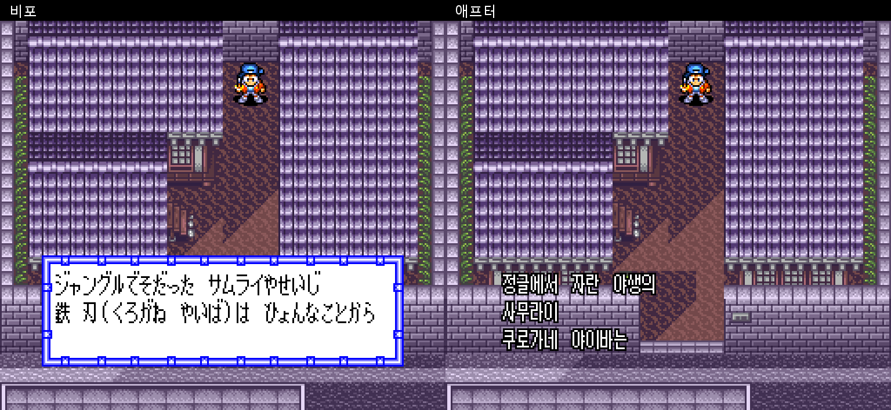
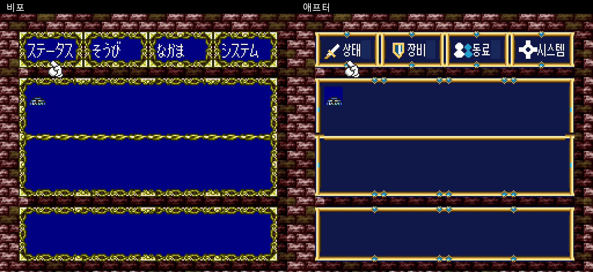
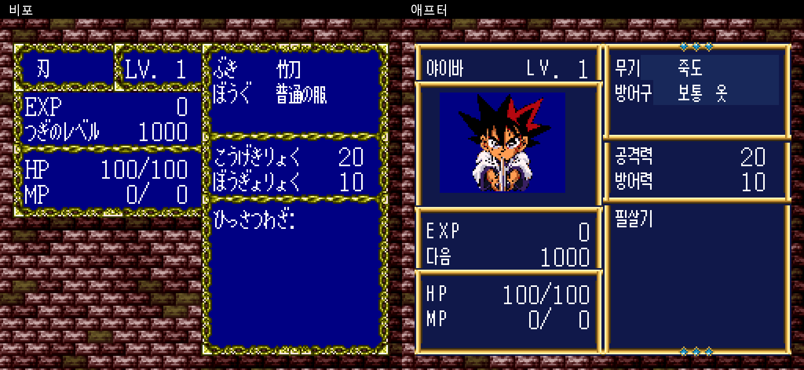

# 검용전설 야이바 한글화 패치 v0.9

슈퍼패미컴 **Kenyuu Densetsu Yaiba (Japan)** 한글화 및 UI 개선 패치입니다.

**[v0.9 다운로드](https://github.com/vol5970-sys/yaiba-korean-patch/releases/tag/v0.9)**

## 적용 내용

- 대사와 주요 메뉴, 지명, 레벨업 메시지, 타이틀·엔딩 표기 한글화
- 흰 대화창 배경·테두리 제거, 흰 글자와 검은 외곽선 적용
- 한글 글꼴과 남색·금색 메뉴 UI 적용
- 야이바·라이·사야카·후우·무사시·게로자에몬·코지로·주베에 초상화 추가
- 새 탑승 목적지 선택창, 비행 지명 표시 개선
- 아군이 받는 피해 숫자를 빨간색으로 표시
- 설정 화면 한글화 및 주베에·팔귀중 이름/용어 정리

v0.9는 개발판입니다. 아직 발견하지 못한 일본어 문구나 화면 문제가 남아 있을 수 있습니다. 발견한 장면과 스크린샷을 Issues에 남겨 주세요.

## 사용법

1. 헤더 없는 일본판 원본 ROM을 준비합니다. 파일 크기는 **1,572,864바이트**입니다.
2. IPS 지원 패치 도구로 `Yaiba_Korean_v0.9.ips`를 원본 ROM에 적용합니다.
3. 생성된 ROM을 에뮬레이터에서 새로 실행합니다.
4. 기존 진행을 이어갈 때는 에뮬레이터를 재시작한 뒤 게임의 **이어하기**를 사용합니다. 이전 버전의 강제 저장 상태 대신 게임 내 저장을 권장합니다.

원본 ROM 및 패치 적용된 ROM은 배포 파일에 포함하지 않습니다.

| 구분 | SHA-256 |
| --- | --- |
| 지원 원본 ROM | `8511950f35be6bc2afd4a8dc2cf7fcbb73a98f42391cb07b7d062a91eff4ba51` |
| 패치 적용 결과 ROM | `2e403bcc3424472c667ca4c212f513de2044743057f7471a5b42c9cbed4ad5eb` |

## 비포·애프터

왼쪽은 일본판 원본, 오른쪽은 한글 패치 적용 화면입니다.

### 대화창 배경 제거

### 메인 메뉴 UI

### 캐릭터 상태 화면

## 글꼴 및 권리

Galmuri 및 달무리 글꼴을 사용했습니다. 해당 라이선스와 출처 정보는 `Galmuri-LICENSE.txt`, `Galmuri-source.json`, `Dalmoori-LICENSE.txt`, `Dalmoori-source.json`에 포함되어 있습니다.

게임·캐릭터·원화의 권리는 각 권리자에게 있습니다. 이 저장소는 비공식 팬 한글화 패치를 배포합니다.
